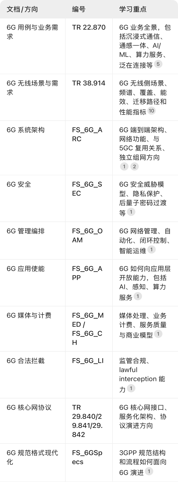
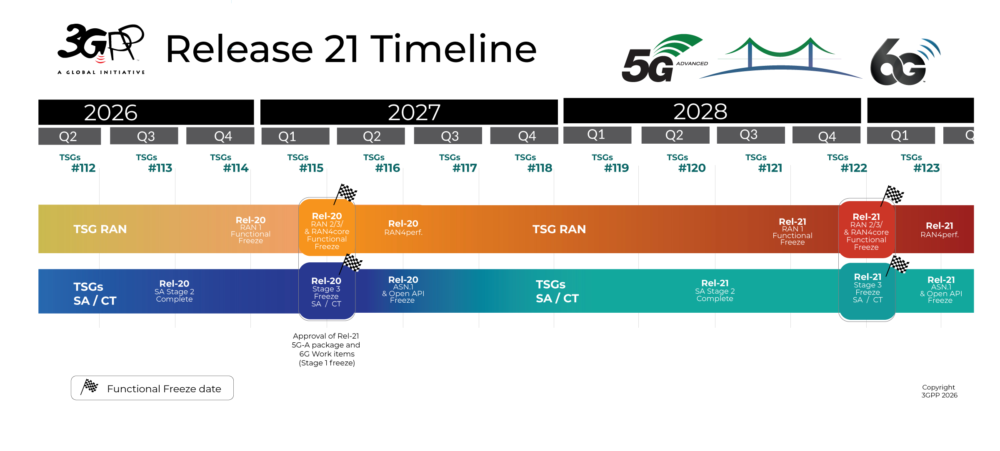

This article introduce the 6G.

<!--more-->

# Overview

# Timeline

[Release 21](https://www.3gpp.org/specifications-technologies/releases/release-21)

**Release 21** will be the first normative 6G release, but will also see a lot of 5G-Advanced specification work, as it continues to full maturity.

TSG SA approved **TR 22.870** – "6G Use Cases and Service Requirements" in Rel-20 and it is set to be the Stage 1 anchor for Rel‑21 normative work.

TSG RAN are scheduled to approve **TR 38.914** – "6G Scenarios and Requirements" in June 2026, which will feed into further WG study towards Rel‑21 NR specification work.

**TR21.921** the "Release description; Release 21", will be approved and published at the end of the Release. Prior to that, draft versions will be available.

# Standards

## ITU Recommendations

## 3GPP Specifications

# Requirements

[TR 22.870 Study on 6G Use Cases and Service Requirements](portal.3gpp.org/desktopmodules/Specifications/SpecificationDetails.aspx?specificationId=4374)

# Network Architecture

# Protocol Architecture

# RF Performance

# References

* [3GPP](http://www.3gpp.org/)
* [Release 21](https://www.3gpp.org/specifications-technologies/releases/release-21)
